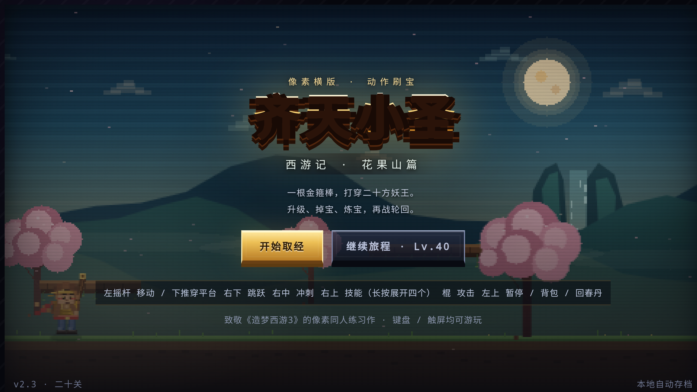
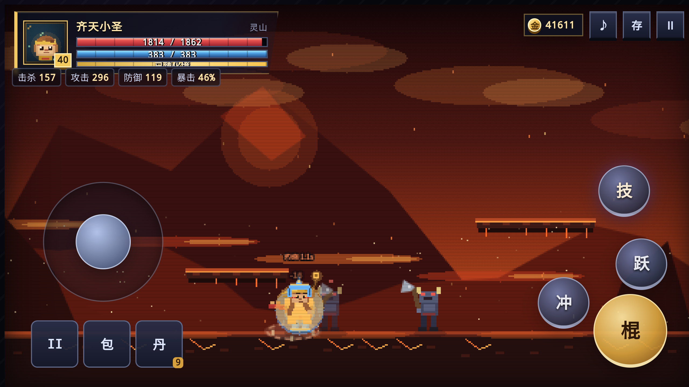
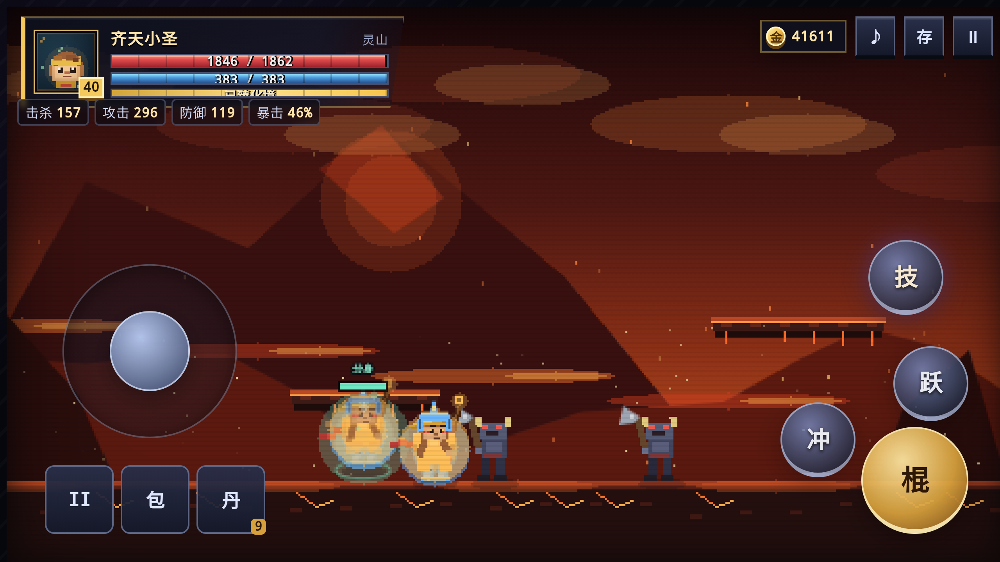
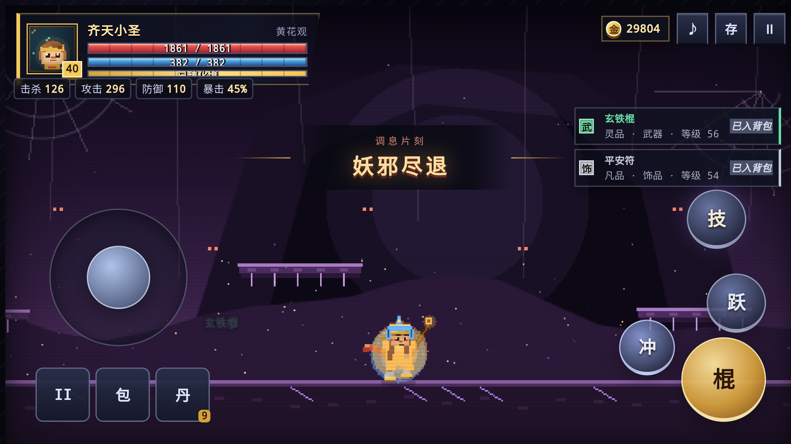
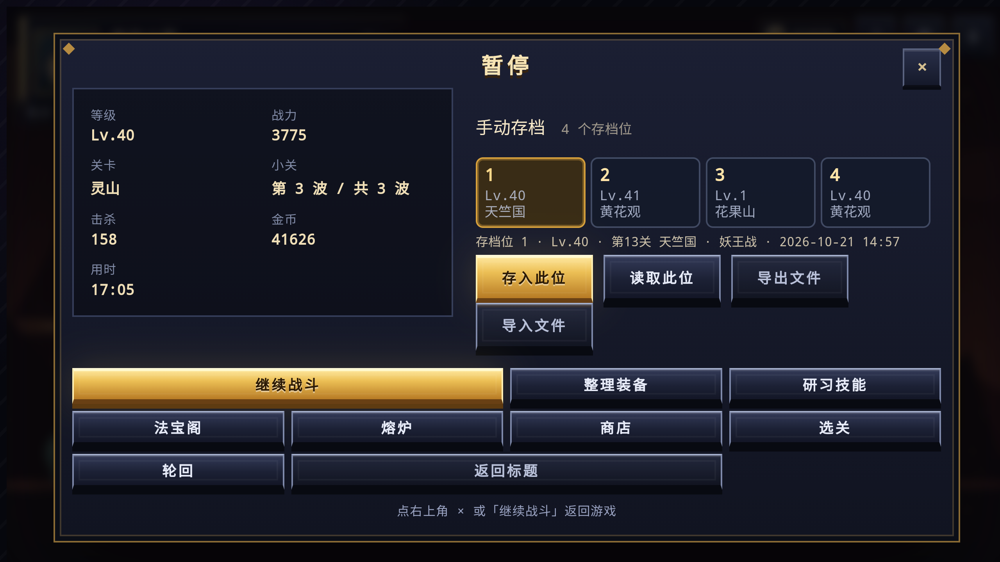
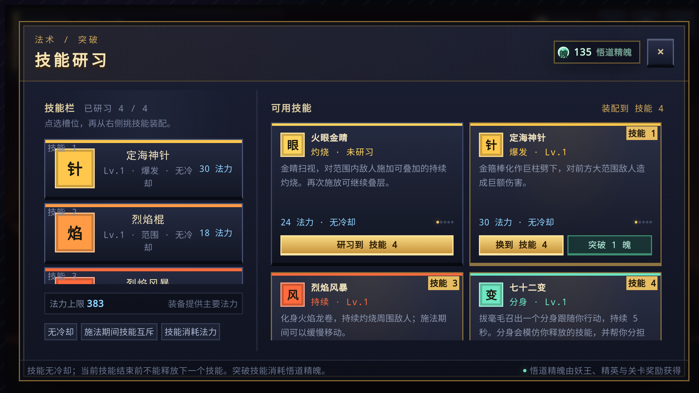
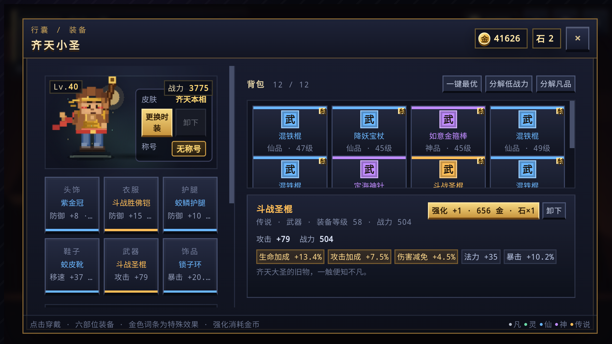

# 齐天小圣 · 像素西游

一个致敬《造梦西游3》的 **2D 横版动作刷宝** 安卓游戏。悟空闯二十关、打妖王、升级、刷装备、炼制法宝，再入轮回。

> 📱 **安卓手机专属版** · 请在横屏下游玩 · 离线可运行 · 自动本地存档

---

## 下载安装

**[⬇ 下载 齐天小圣-像素西游.apk](齐天小圣-像素西游.apk)** （约 13.6 MB）

1. 在手机上打开上面的链接下载 APK
2. 系统提示时，允许「安装未知来源应用」
3. 安装完成即可离线开玩，**无需联网**

| 项目 | 说明 |
| --- | --- |
| 包名 | `com.xiyou.pixelwukong` |
| 支持系统 | Android 7.0 (API 24) 及以上 |
| 屏幕方向 | 强制横屏（`sensorLandscape`） |
| 权限 | 仅网络权限（游戏本体完全离线） |
| 签名 | debug 签名，自用包，非应用商店版本 |

---

## 实机运行截图

以下截图均取自 **雷电模拟器实机运行**（Android 9 · 2560×1440 横屏），
不是设计稿，也不是浏览器渲染的预览图。

### 标题与战斗

| 标题画面 | 战斗中 |
| --- | --- |
|  |  |

### 七十二变分身

召唤的分身会跟随本体 5 秒，头顶带专属血条与「分身」标签。

### 战斗提示

战斗中的掉落与状态提示保持紧凑，不遮挡主角。

### 暂停与四个存档位

### 技能研习

「七十二变」已装配到第 4 个技能栏。

### 背包装备

### 截图清单

| 文件 | 内容 |
| --- | --- |
| `screenshots/01-title.png` | 标题画面（含「继续旅程」） |
| `screenshots/02-gameplay.png` | 战斗画面与 HUD |
| `screenshots/03-clone.png` | 七十二变分身 |
| `screenshots/04-toast.png` | 战斗提示卡片 |
| `screenshots/05-pause.png` | 暂停菜单与 4 个存档位 |
| `screenshots/06-skills.png` | 技能研习界面 |
| `screenshots/07-inventory.png` | 背包装备与词条 |

---

## 操作方式

本作为触屏操作设计，布局分左右两块：

| 位置 | 作用 |
| --- | --- |
| 左下 摇杆 | 移动；下推可穿过浮空平台 |
| 右下 金色「棍」 | 攻击，按住可自动连招 |
| 右下「跃」 | 跳跃，空中再按一次二段跳翻滚 |
| 右中「冲」 | 筋斗云闪避，短暂无敌 |
| 右上「技」 | 点按施放技能，长按展开四个技能槽 |
| 左上三个小键 | 暂停 / 背包 / 回春丹 |
| 左上状态条 | 击杀 · 攻击 · 防御 · 暴击，实时更新 |

---

## 游戏特色

- 二十关、二十方妖王，小怪与 Boss 数值随关卡递增
- 六部位装备 + 特殊词条，让刷到的每件装备都可能改变玩法
- 三技能栏 + 五技能池，无冷却但施法互斥，靠装备堆法力
- 商店、熔炉、选关、轮回、时装、称号六大系统
- 金币与轮回石双经济，10000 金币可换 1 枚轮回石
- 法宝：玉净瓶、番天印、东皇钟、诛仙剑、昆仑镜
- 480×270 低分辨率 Canvas 放大，程序化像素美术 + WebAudio 芯片音效

---

## 更新记录

### v2.6（当前）

**界面**
- 战斗提示卡片缩小：宽度 22em → 15em，高度减半，位置上移避开主角，占屏比从约 8% 降到 **2.2%**
- 提示去重：同类提示不再堆叠，最多同时显示 2 条

**技能**
- 修复**第 4 个技能槽无法选中**：选中逻辑上限写死为 2，而界面有 4 个槽位，导致「变」等技能永远装不进去
- **「七十二变」重做为简单分身**：
  - 固定存在 **5 秒**，不随等级延长
  - 只跟随本体，**不再自动攻击敌人**
  - 仍会模仿本体技能，并分担部分伤害
  - 青绿光环 + 地面圆环 + 头顶「分身」血条，与本体明确区分

### v2.5

| 问题 | 处理 |
| --- | --- |
| 退出游戏丢进度 | 切后台 / 退出 / 页面卸载均立即写入存档（原先只暂停不存档，1.2 秒防抖窗口内的进度会丢） |
| 手动存档只有 1 个 | 扩展为 **4 个独立存档位**，可分别存入与读取 |
| 摇杆圆形转盘越用越偏 | 松手后未还原 `absolute` 定位，每拖一次偏移一点，最终跑出屏幕；现已还原并加全局兜底 |
| 长按「技」展开太慢 | 阈值 260ms → **130ms** |
| 第一关打完无法进入下一关 | 原逻辑要求跳跃键在玩家恰好位于 32px 窗口那一帧处于按下状态，实际几乎不可能；改为走进传送门即触发 |

### v2.4

| 问题 | 处理 |
| --- | --- |
| 缺少 `viewport-fit=cover` | `env(safe-area-inset-*)` 恒为 0，安全区适配全部失效，刘海会遮挡血条与按钮 |
| 法宝面板纵向堆叠 | 横屏只有约 300px 高，法宝列表被裁掉一半；改为左右两栏，5 件一屏可见 |
| 装备 / 技能列溢出面板 | grid 子项 `min-height:auto` 不肯收缩，内容被裁切；逐层补 `min-height:0` |
| `frame()` 异常被吞掉 | `requestAnimationFrame` 在函数第一行，渲染报错后画面卡死且不报错 |
| 背景渐变每帧重建 | 7 个场景天空渐变每帧重建，低端机有开销；改为按 key 缓存 |

**界面优化**：新增常驻属性条（击杀 / 攻击 / 防御 / 暴击）、「技」键提亮、按钮对比度提升、技能不可用时自动变暗。

---

## 说明

本仓库只提供**安卓安装包与实机截图**，不包含网页版。

致敬《造梦西游3》的像素同人练习作。
