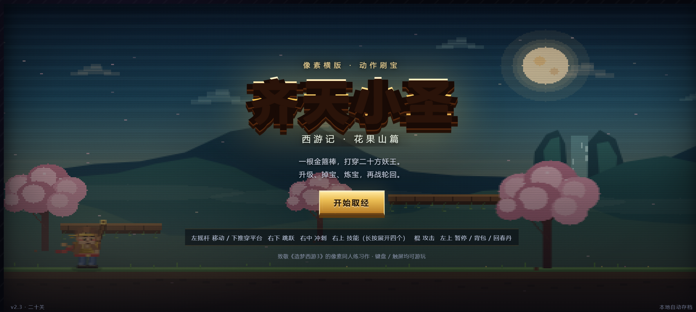
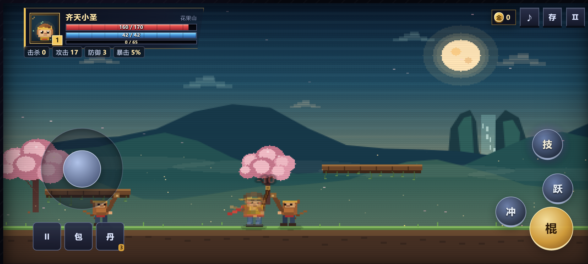
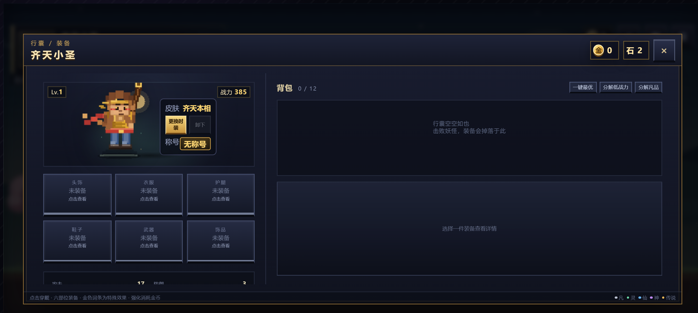
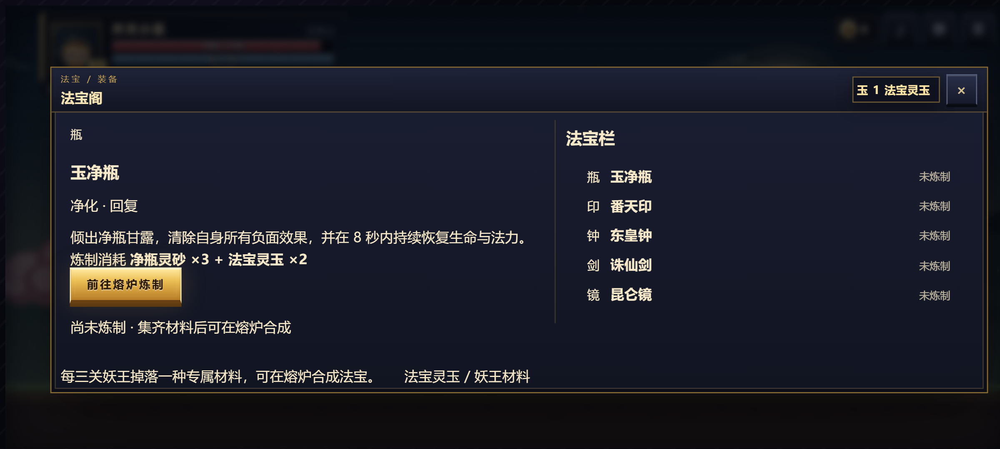
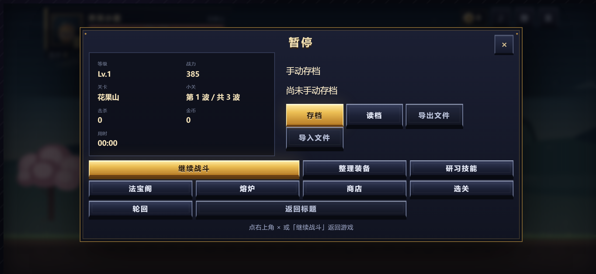

# 齐天小圣 · 像素西游

一个致敬《造梦西游3》的 **2D 横版动作刷宝** 安卓游戏。悟空闯二十关、打妖王、升级、刷装备、炼制法宝，再入轮回。

> 📱 **安卓手机专属版** · 请在横屏下游玩 · 离线可运行 · 自动本地存档

---

## 下载安装

**[⬇ 下载 齐天小圣-像素西游.apk](齐天小圣-像素西游.apk)** （约 13.6 MB）

1. 在手机上打开上面的链接下载 APK
2. 系统提示时，允许「安装未知来源应用」
3. 安装完成即可离线开玩，**无需联网**

| 项目 | 说明 |
| --- | --- |
| 包名 | `com.xiyou.pixelwukong` |
| 支持系统 | Android 7.0 (API 24) 及以上 |
| 屏幕方向 | 强制横屏（`sensorLandscape`） |
| 权限 | 仅网络权限（游戏本体完全离线） |
| 签名 | debug 签名，自用包，非应用商店版本 |

---

## 手机运行截图

截图取自各类主流手机的横屏分辨率与安全区参数（刘海 / 挖孔 / 手势条）。

### 游戏画面

| 标题 | 战斗 |
| --- | --- |
|  |  |

### 背包与法宝

| 背包装备 | 法宝阁 |
| --- | --- |
|  |  |

### 暂停菜单

### 全部截图

| 文件 | 机型 |
| --- | --- |
| `screenshots/pixel8-*` | Google Pixel 8 · 2400×1080 · DPR 2.625 · 左侧挖孔 |
| `screenshots/xiaomi14-*` | Xiaomi 14 · 2670×1200 · DPR 2.75 · 居中挖孔 |
| `screenshots/iphone15pro-*` | iPhone 15 Pro · 2556×1179 · DPR 3 · 双侧刘海 |
| `screenshots/smallscreen-*` | 小屏 16:9 手机 · 1280×720 · DPR 2 |
| `screenshots/tablet-*` | 平板横屏 · 1600×2560 · DPR 2 |

每个机型都包含五张：`-01-title` 标题、`-02-gameplay` 战斗、`-03-pause` 暂停、`-04-inventory` 背包、`-05-artifact` 法宝。

---

## 操作方式

本作为触屏操作设计，布局分左右两块：

| 位置 | 作用 |
| --- | --- |
| 左下 摇杆 | 移动；下推可穿过浮空平台 |
| 右下 金色「棍」 | 攻击，按住可自动连招 |
| 右下「跃」 | 跳跃，空中再按一次二段跳翻滚 |
| 右中「冲」 | 筋斗云闪避，短暂无敌 |
| 右上「技」 | 点按施放技能，长按展开四个技能槽 |
| 左上三个小键 | 暂停 / 背包 / 回春丹 |
| 左上状态条 | 击杀 · 攻击 · 防御 · 暴击，实时更新 |

---

## 游戏特色

- 二十关、二十方妖王，小怪与 Boss 数值随关卡递增
- 六部位装备 + 特殊词条，让刷到的每件装备都可能改变玩法
- 三技能栏 + 五技能池，无冷却但施法互斥，靠装备堆法力
- 商店、熔炉、选关、轮回、时装、称号六大系统
- 金币与轮回石双经济，10000 金币可换 1 枚轮回石
- 法宝：玉净瓶、番天印、东皇钟、诛仙剑、昆仑镜
- 480×270 低分辨率 Canvas 放大，程序化像素美术 + WebAudio 芯片音效

---

## 本版更新（v2.4）

### 修复的问题

| 问题 | 影响 | 处理 |
| --- | --- | --- |
| 缺少 `viewport-fit=cover` | CSS 里所有 `env(safe-area-inset-*)` 恒为 0，安全区适配**全部失效**，刘海 / 挖孔会遮挡血条与按钮 | 补上 `viewport-fit=cover`，安全区变量真正生效 |
| 安全区未接入布局 | HUD 左上角、触控按钮、全屏面板都贴边渲染 | 全部改为 `max(基准值, 安全区)` |
| 法宝面板纵向堆叠 | 内容需约 520px、横屏只有约 300px，**法宝列表被裁掉一半**，必须滚动才看得全 | 触屏下改为左右两栏，5 件法宝一屏可见、无需滚动 |
| 装备 / 技能列溢出面板 | grid 子项默认 `min-height:auto` 不肯收缩，内容越过面板被裁切 | 逐层补 `min-height:0`，各列在面板内正常滚动 |
| `frame()` 异常被吞掉 | `requestAnimationFrame` 放在函数第一行，渲染报错后循环继续但画面卡死，且不报错 | 加 try/catch 并限频记录错误，前 3 次打印到控制台 |
| 背景渐变每帧重建 | 7 个场景的天空渐变每帧 `createLinearGradient`，低端机有明显开销 | 渐变对象按 key 缓存，只创建一次 |

### 界面优化

- **新增常驻属性条**：手机端原本看不到攻击 / 防御 / 暴击，现在显示在血条下方
- **「技」技能键提亮**：原来是洗淡的紫色，现改为高对比紫色辉光，与金色「棍」主键区分
- **按钮整体对比度提升**：跳跃 / 冲刺 / 暂停键在亮色天空下更易辨认
- **技能可用性反馈**：法力不足或施法中，「技」键自动变暗
- 长按不再触发文字选择 / 系统呼出菜单

---

## 说明

本仓库只提供**安卓安装包与手机截图**，不包含网页版。

致敬《造梦西游3》的像素同人练习作。
